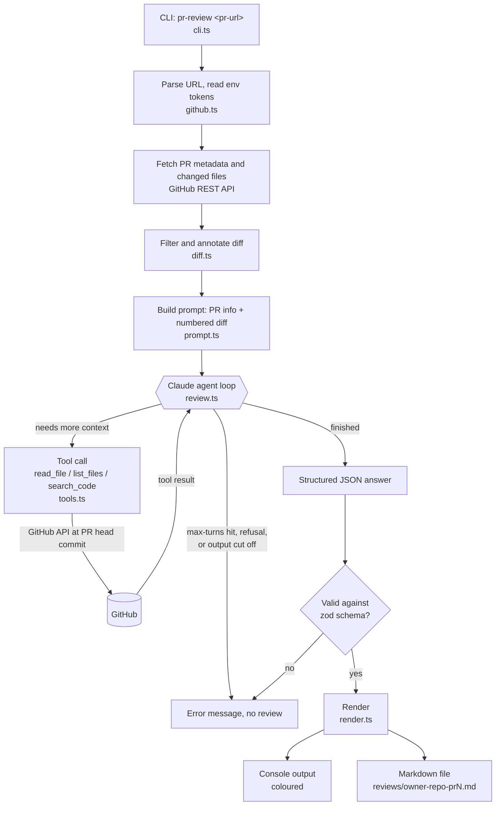

# pr-review-agent

A CLI AI agent that reviews a GitHub pull request, similar to Copilot code review. Give it a PR URL and it prints a short review and saves it as `reviews/<owner>-<repo>-pr<number>.md`:

- 📁 **Modified Files**: a plain list of every changed file
- 🌟 **What's Great**: up to 3 specific, honest points
- 🐞 **Possible Bugs & Security Issues**: for each, a title with severity, the location, the offending code, short "Issues" bullets, and a "Recommendation" code block with the fix
- 🧪 **Missing Tests**: one line per file naming the cases to cover

Style and "best practice" remarks are deliberately left out so the review stays on point.

The agent is a Claude tool-use loop. Besides the diff it can call read-only tools (`read_file`, `list_files`, `search_code`) to check surrounding code and existing tests before it reports something. It does not clone the repo and it never writes to GitHub.

## Setup

```bash
npm install
```

The variables below are read from your environment. A `.env` file is **not** loaded automatically; set them in your shell (PowerShell: `$env:ANTHROPIC_API_KEY = "..."`, bash: `export ANTHROPIC_API_KEY=...`), or in your OS environment settings.

| Variable | Purpose |
|---|---|
| `GITHUB_TOKEN` | Read access to the repo (`repo` scope for private repos). Optional for public repos, but raises rate limits. |
| `ANTHROPIC_API_KEY` | Anthropic key. Alternatively run `ant auth login`. |

## Usage

```bash
npm run dev -- https://github.com/<owner>/<repo>/pull/<number>

# options
npm run dev -- <pr-url> --model claude-sonnet-5-5   # cheaper model
npm run dev -- <pr-url> --effort medium             # less thinking, lower cost
npm run dev -- <pr-url> --json                      # machine-readable output
```

| Flag | Default | |
|---|---|---|
| `--model` | `claude-opus-5-5` | Any Claude model ID |
| `--effort` | `high` | `low` / `medium` / `high` / `xhigh` / `max` |
| `--max-files` | `40` | Files included in the review. Skipped files are listed in the output. |
| `--max-turns` | `12` | Cap on agent tool-use rounds |
| `--out-dir` | `reviews` | Where the Markdown file is saved. Re-reviewing the same PR overwrites its file. |
| `--no-save` | off | Don't write the Markdown file |
| `--json` | off | Print the raw result as JSON instead of the formatted review |

To install as a command: `npm run build && npm link`, then `pr-review <url>`.

Progress (fetching, tool calls) goes to stderr and the review goes to stdout, so `pr-review <url> > review.txt` works.

## How it's built

**Stack:** TypeScript on Node 22, no agent framework. Just the official Anthropic SDK (`@anthropic-ai/sdk`), `zod` for schemas, and Node's built-in `fetch` for the GitHub REST API.

**Model:** `claude-opus-5-5` by default (`--model` to change), with adaptive thinking and `effort: high`.

**Flow:**
1. `github.ts` fetches PR metadata and per-file patches from the GitHub REST API.
2. `diff.ts` drops lockfiles, generated and binary files, and prefixes each diff line with its new-file line number so findings cite real lines. Anything skipped or truncated is reported to the model and in the output.
3. `review.ts` runs the agent loop and validates the answer (`schema.ts`).
4. `render.ts` renders it twice: coloured for the terminal and Markdown for the saved file.



**How it calls tools:** the SDK's tool runner (`client.beta.messages.toolRunner`) drives the loop. Each tool in `tools.ts` is declared with `betaZodTool`: a name, a zod input schema, and a `run` function. The model calls a tool, the runner executes it and feeds the result back, and this repeats until the model stops asking for tools or hits `--max-turns`. The tools (`read_file`, `list_files`, `search_code`) only call the GitHub API at the PR's head commit, so there is no shell, no filesystem access and no writes.

**How the final answer is produced:** the review schema is passed as the structured-output format (`output_config.format`), and the last message is parsed and validated with zod. A forced "submit review" tool call isn't used, because Opus 5.5 rejects forced `tool_choice`.

## What went wrong and how it was handled

- **The first review was too long.** It had a summary, a verdict, a "better practices" section and long explanations. I cut the schema to the four sections wanted, capped praise at 3 one-sentence points, limited each bug to 1-3 terse bullets, and told the prompt to leave out style remarks. The first live run after that was short.
- **The saved Markdown didn't match the reference layout.** The first version used a table with file stats and a red/green diff block. I changed it to the reference format: bare file list, then per issue a title with severity, Location, code, Issues bullets and Recommendation. Two smaller differences from the screenshot (indented code, file name in Location) were also fixed. Location now omits the file name for single-file reviews.
- **Models miscount line numbers.** I pre-number every diff line, so findings cite numbers the model can read instead of counting. This is a mitigation, and I haven't yet checked the reported line numbers against the real diff.
- **Reviews vary between runs.** Two runs on the same PR found the same issue with different wording. I haven't tried to make this deterministic.
- **A `.env` file was assumed but never loaded.** The project only reads real environment variables, and the README now says so.
- **Constraints designed around, not hit at runtime:** the SDK's non-streaming size limit (kept `max_tokens` at 16000) and no forced tool calls on Opus 5.5 (see above).

**Known open problem:** the model sometimes cuts code snippets off partway through a block (for example ending at `} catch (err) {`), so the Recommendation isn't always valid code.

## What I'd do next

1. **Fix cut-off snippets:** require complete statements in the prompt and schema, and add a check that flags unbalanced brackets.
2. **Verify line numbers automatically:** drop or flag any finding whose cited lines aren't in the PR diff.
3. **Build a small eval set:** a handful of PRs with known bugs, to measure whether prompt or model changes help or hurt, and to compare models.
4. **Post inline comments to the PR** with an opt-in `--post` flag, and offer a GitHub Action so it runs on every pull request.
5. **Support other LLM providers** through a thin interface with one adapter per provider.
6. **Load a `.env` file** (Node 22 has a built-in loader).
7. **Review only the new commits** when a PR is updated, instead of the whole diff.

## Safety

- PR content is untrusted. The prompt tells the model to treat it as data, and the tools are read-only and limited to the PR's repo.
- Tokens are read from the environment only and are never logged.
- Token use is capped by file count, diff size, turn count and `max_tokens`.

## Develop

```bash
npm test          # unit tests (vitest)
npm run typecheck
```
